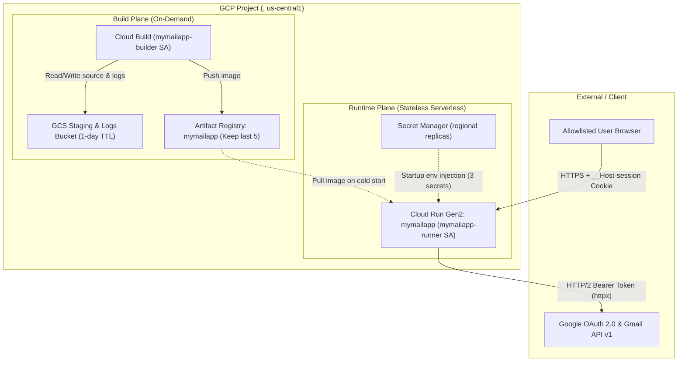
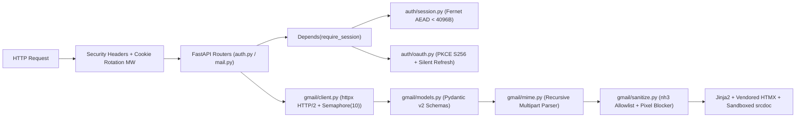

# Architecture Design & Implementation Plan: MyMailApp

**Companion Spec:** [PRD.md](./PRD.md)  
**Target Runtime:** Google Cloud Run Gen2 (Greenfield GCP Project)  
**Default Region:** `us-central1` (Tier 1 pricing, Cloud Run Free Tier eligible)  

---

## 1. Cloud Infrastructure Architecture

### 1.1 Topology Overview

### 1.2 Eliminating the OAuth Redirect URI Chicken-and-Egg Trap
Every Cloud Run service in GCP automatically receives a deterministic regional URL derived from the immutable project number:
`https://mymailapp-<PROJECT_NUMBER>.<REGION>.run.app`

By querying `PROJECT_NUMBER` during bootstrap (`01-bootstrap-gcp.sh`) and pinning `APP_BASE_URL` to that deterministic URL, we know the exact OAuth callback (`https://mymailapp-<PROJECT_NUMBER>.<REGION>.run.app/auth/callback`) **before** building or deploying the first container. No two-pass redeploy is required.

> [!IMPORTANT]
> **Critical API Often Forgotten (`gmail.googleapis.com`):** Even though Gmail is accessed with an end-user OAuth token rather than a service account, Google checks whether `gmail.googleapis.com` is enabled on the **OAuth Client's host GCP project**. Leaving it disabled triggers an immediate `403 accessNotConfigured` on first login. Script `01-bootstrap-gcp.sh` enables it explicitly alongside the 5 infrastructure APIs.

### 1.3 Zero-Trust IAM & Resource Matrix

We do **not** use the default Compute Engine service account (`<project-number>-compute@developer.gserviceaccount.com`). Instead, we provision two single-purpose service accounts with resource-scoped bindings:

| Principal | Scope of Binding | IAM Role / Setting | Purpose |
|---|---|---|---|
| `mymailapp-runner@...` | **Project-level** | *(None — zero roles)* | App uses user OAuth tokens, never GCP IAM credentials, to read Gmail. |
| `mymailapp-runner@...` | Secret: `mymailapp-oauth-client-id` | `roles/secretmanager.secretAccessor` | Read OAuth Client ID at container startup. |
| `mymailapp-runner@...` | Secret: `mymailapp-oauth-client-secret` | `roles/secretmanager.secretAccessor` | Read OAuth Client Secret at container startup. |
| `mymailapp-runner@...` | Secret: `mymailapp-session-key` | `roles/secretmanager.secretAccessor` | Read 32-byte Fernet AEAD key for cookie encryption. |
| `mymailapp-builder@...` | Bucket: `gs://<PROJECT_ID>-mymailapp-build` | `roles/storage.admin` | `storage.buckets.get` + stage source tarball & write build logs (1-day auto-delete). |
| `mymailapp-builder@...` | Repo: `mymailapp` (Artifact Registry) | `roles/artifactregistry.writer` | Push built container layers. |
| `mymailapp-builder@...` | **Project-level** | `roles/logging.logWriter` | Stream Cloud Build logs to Cloud Logging. |
| Cloud Run Ingress | Service: `mymailapp` | `--no-invoker-iam-check` | Public HTTPS ingress compatible with Domain Restricted Sharing org policies; gated by in-app OAuth. |

---

## 2. Application Software Architecture

### 2.1 Component Responsibilities & Data Boundaries

### 2.2 Key Internal Design Specifications

1. **Configuration (`src/mymailapp/config.py`):**
   - `Settings(BaseSettings)` with `model_config = SettingsConfigDict(extra="forbid", frozen=True)`.
   - Fields: `environment: Literal["development", "production"]`, `app_base_url: str`, `google_client_id: str`, `google_client_secret: SecretStr`, `session_encryption_key: SecretStr`, `gmail_max_concurrency: int = 10`, `inline_cid_max_bytes: int = 2_097_152`.
   - Computed cookie properties: `__Host-session` / `__Host-oauth_state` (`Secure=True`) when `environment == "production"`, cleanly downgrading to `dev_session` / `dev_oauth_state` (`Secure=False`) only on `http://localhost`.

2. **AEAD Cookie Engine & Silent Token Rotation (`src/mymailapp/auth/`):**
   - `session.py`: Wraps `cryptography.fernet.Fernet` with explicit TTL validation (`ttl_seconds=604800` for session, `300` for PKCE login state) and an assertion raising `SessionOverflowError` if serialized ciphertext exceeds `3800` bytes (leaving headroom for cookie attributes under the 4096-byte browser ceiling).
   - `oauth.py` + `require_session` dependency:
     - Checks `session.expires_at - now <= 60`. If expiring, exchanges `refresh_token` via `POST https://oauth2.googleapis.com/token` before executing the route handler and stages the new `SessionPayload` on `request.state.updated_session`.
     - An HTTP middleware inspects `request.state.updated_session` and attaches the rotated `Set-Cookie` header to outgoing HTML, HTMX partial, or attachment download responses.
     - If Google returns `400 invalid_grant` (e.g., 7-day Testing refresh token cap), raises `ReauthRequiredError`, caught globally to delete `__Host-session` and emit either `HX-Redirect: /auth/login` (for HTMX requests) or `302 /auth/login`.

3. **Async Gmail Client & Quota Guardrails (`src/mymailapp/gmail/client.py`):**
   - Single lifespan-managed `httpx.AsyncClient(http2=True, timeout=httpx.Timeout(15.0, connect=5.0))`.
   - `search_threads(token, q, page_token, max_results=20)`: Calls `GET /threads` (`10` quota units), then hydrates summaries concurrently under `asyncio.Semaphore(10)` via `GET /threads/{id}?format=metadata&metadataHeaders=Subject&metadataHeaders=From&metadataHeaders=Date`.
   - Maps upstream `401` -> `ReauthRequiredError`, `403 rateLimitExceeded` / `429` -> user-readable `503 Retry-After` screen, and `404` -> `404 Thread Not Found`.

4. **Recursive MIME & Dual-Layer XSS Isolation (`src/mymailapp/gmail/mime.py`, `sanitize.py`):**
   - Walks nested `MessagePart` trees recursively:
     - Prefers `text/html` over `text/plain` within `multipart/alternative`; collects non-body parts or parts with `filename` + `body.attachmentId` as `AttachmentView`.
     - Resolves `cid:<Content-ID>` inline images inside `multipart/related` up to `2 MiB` via `data:<mime>;base64,...` substitution.
   - `sanitize_email_html(raw_html, allow_remote_images=False)`:
     - Uses `nh3.clean()` with an explicit tag/attribute allowlist, stripping `<script>`, `<iframe>`, `<form>`, `<object>`, `<svg>`, `javascript:`/`data:` URLs, and `on*` handlers.
     - Strips external `http://` / `https://` `` URLs when `allow_remote_images=False`, displaying a per-message **"Load remote images"** opt-in toggle (`?load_images=true`).
   - Template embeds sanitized HTML inside `<iframe sandbox="" referrerpolicy="no-referrer" srcdoc="...">`. Vendoring `htmx.min.js` locally in `src/mymailapp/static/` allows a strict global header:
     `Content-Security-Policy: default-src 'self'; script-src 'self'; style-src 'self' 'unsafe-inline'; img-src 'self' data: https:; frame-ancestors 'none'; base-uri 'none'; form-action 'self'`.

5. **Hardened Container Build (`Dockerfile`):**
   - Two-stage build on `python:3.12-slim-bookworm`:
     - **Builder stage:** Uses `ghcr.io/astral-sh/uv:0.12.0`, runs `uv sync --frozen --no-dev --no-editable` with `--compile-bytecode`.
     - **Runtime stage:** Copies `.venv` only (no compiler, no `uv`, no `pip`), runs `uvicorn mymailapp.main:create_app --factory --host 0.0.0.0 --port ${PORT:-8080} --proxy-headers --forwarded-allow-ips='*'` as unprivileged `uid=65532(nonroot)`.
   - Exposes `/health` (and `/healthz` for internal container probes; note Google Frontend intercepts `/*z` paths externally on `*.run.app`).

---

## 3. Phased Implementation Summary

| Phase | Scope | Key Files | Verification Gate |
|---|---|---|---|
| **Phase 1: Project Scaffold & Config** | `uv` workspace (Python 3.12+), strict `ruff` & `pytest` configs, `Settings` validation (`extra="forbid"`). | `pyproject.toml`, `uv.lock`, `src/mymailapp/config.py`, `tests/test_config.py` | `uv run ruff check .` & `uv run pytest` pass. |
| **Phase 2: AEAD Session & OAuth PKCE** | Fernet session seal/unseal (`< 4 KB` ceiling), PKCE `S256` challenge, `state` verification, silent token refresh, and `/auth/*` routes. | `src/mymailapp/auth/session.py`, `src/mymailapp/auth/oauth.py`, `src/mymailapp/routes/auth.py`, `tests/test_session.py`, `tests/test_oauth.py` | Parameterized tests for bit-flip tamper, expired TTL, CSRF mismatch, and `400 invalid_grant` recovery. |
| **Phase 3: Gmail Client, MIME & Sanitizer** | HTTP/2 `GmailClient` (`Semaphore(10)`), Pydantic v2 Gmail models, recursive MIME walker (`cid:` + attachments), and `nh3` sanitizer + pixel blocker. | `src/mymailapp/gmail/{client,models,mime,sanitize}.py`, `tests/test_mime_sanitize.py`, `tests/test_gmail_client.py` | `respx` unit tests for nested `multipart/*`, hostile XSS payloads, and quota/401 error translation. |
| **Phase 4: Routes, HTMX UI & Sandboxed Reader** | `/`, `/search`, `/threads/{id}`, `/messages/{m}/attachments/{a}`, CSP/security middleware, vendored `htmx.min.js`, and responsive semantic CSS. | `src/mymailapp/main.py`, `src/mymailapp/routes/mail.py`, `src/mymailapp/templates/*.html`, `src/mymailapp/static/*`, `tests/test_routes.py` | Full async `httpx.ASGITransport` integration tests covering login -> search -> thread iframe -> RFC 5987 attachment download. |
| **Phase 5: Container & GCP Scripts** | Hardened multi-stage `Dockerfile`, `.dockerignore`, `.gcloudignore`, `.env.example`, and parameterized `scripts/01..04-*.sh`. | `Dockerfile`, `.dockerignore`, `.gcloudignore`, `.env.example`, `scripts/*.sh` | `bash -n scripts/*.sh` syntax check + full `ruff` & `pytest` suite green. |
| **Phase 6: Cloud Provisioning & Deploy** | Execute `01-bootstrap-gcp.sh`, complete OAuth Console checkpoint, run `02-store-oauth-secrets.sh`, and deploy via `03-deploy.sh`. | Live Cloud Run service (`us-central1`) | `/health` returns `200`, `/` redirects `302 /auth/login`, end-to-end Gmail search & attachment test succeeds. |
