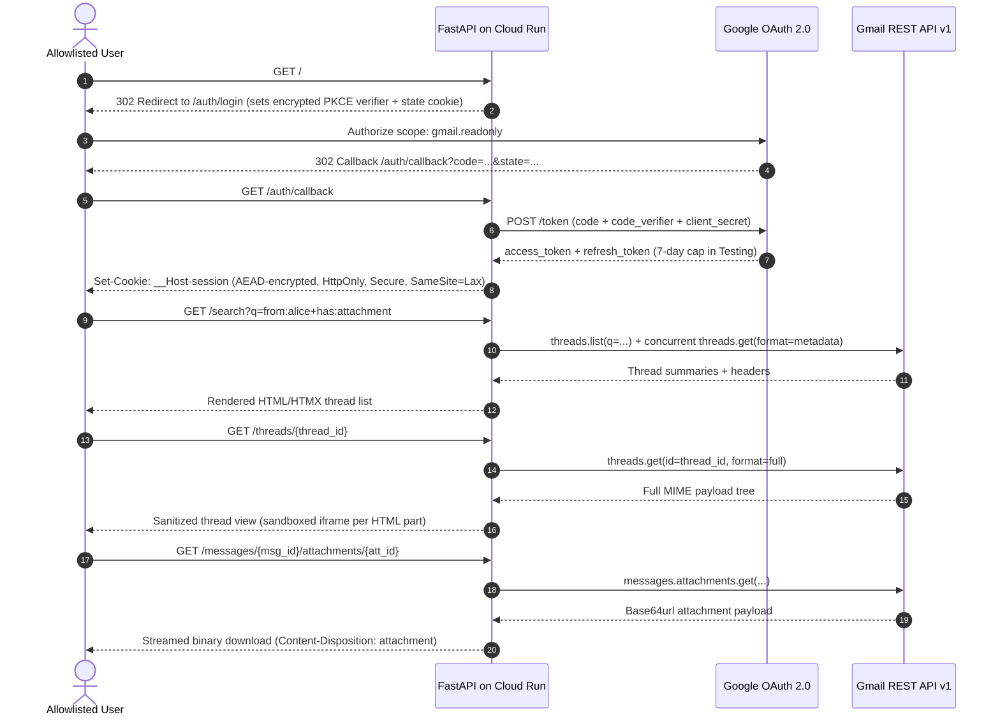
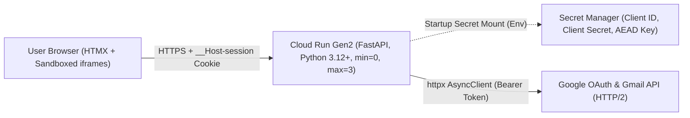

# Product Requirements Document: MyMailApp

**Status:** Draft for Review  
**Target Runtime:** Google Cloud Run (Serverless, Stateless)  
**Stack:** Python 3.12+, `uv`, FastAPI, `httpx` (HTTP/2), Jinja2 + HTMX, Pydantic v2  

---

## 1. Problem Statement & Product Goal

Provide allowlisted users with a fast, zero-persistence web interface to search their Gmail inbox using native Gmail query operators, read full conversation threads, and download attachments—while enforcing the strictest possible read-only OAuth boundary and storing zero mail or token state on backend infrastructure.

### Explicit Non-Goals
- Sending, replying, forwarding, drafting, trashing, or modifying labels/read-state.
- Persisting emails, search history, attachments, or OAuth tokens in any database or object store.
- Multi-account inbox aggregation or background offline indexing.
- Public Google Workspace Marketplace / CASA Tier 2 production publishing.

---

## 2. Security & Least-Privilege OAuth Boundary

> [!IMPORTANT]
> **Why `gmail.readonly` Instead of `gmail.metadata`:** Although `https://www.googleapis.com/auth/gmail.metadata` has a smaller permission surface, the Gmail API explicitly blocks the `q` search parameter (`403 Forbidden: Metadata scope does not support 'q' parameter`) and strips message bodies and attachments. `https://www.googleapis.com/auth/gmail.readonly` is therefore the strict mathematical minimum scope for this product.

### 2.1 OAuth 2.0 Configuration
| Parameter | Specification | Rationale |
|---|---|---|
| **Scope** | `https://www.googleapis.com/auth/gmail.readonly` | Exclusive scope requested. No `openid`, `profile`, or `email` scopes needed (`users.getProfile` supplies the address). |
| **Publishing Status** | **Testing** (External, allowlisted up to 100 test users) | Avoids CASA Tier 2 audit (~$500–$4,500+/yr) required for public Restricted Scopes. |
| **Grant Flow** | Authorization Code + **PKCE (`S256`)** + `state` nonce | Prevents authorization code interception and login CSRF. |
| **Token Storage** | AEAD-encrypted (`Fernet` / AES-128-CBC+HMAC or AES-256-GCM) cookie | Standard Starlette `SessionMiddleware` only *signs* cookies (base64 plaintext). Tokens **must** be encrypted at rest in the browser cookie (`HttpOnly`, `Secure`, `SameSite=Lax`, `< 4096` bytes). |
| **Testing-Mode Expiry** | Graceful `invalid_grant` catch -> redirect `/auth/login` | Google expires refresh tokens after **7 days** for apps in Testing mode. |
| **Sign-Out & Revocation** | `POST /auth/logout` calls `oauth2.googleapis.com/revoke` + clears cookie | Ensures immediate server-side token invalidation at Google, not merely cookie deletion. |

### 2.2 OAuth & Request Sequence



---

## 3. Functional Requirements

### FR-1: Authentication & Session Lifecycle
1. **Unauthenticated Gate:** Every mail route (`/`, `/search`, `/threads/*`, `/messages/*`) requires a valid decrypted session; unauthenticated requests redirect to `/auth/login` (or return `HX-Redirect: /auth/login` for HTMX partial requests).
2. **Active Inbox Header:** Display the authenticated user's email address fetched via `GET /gmail/v1/users/me/profile` alongside a one-click **Sign Out & Revoke** button (`POST /auth/logout`).
3. **Silent Token Refresh:** If `access_token` is within 60 seconds of expiry and a `refresh_token` is present, transparently refresh via `oauth2.googleapis.com/token` and rotate the `__Host-session` cookie on the response. If Google returns `400 invalid_grant`, purge the cookie and redirect to `/auth/login`.

### FR-2: Inbox Search & Pagination
1. **Query Input:** Support the full Gmail search syntax (`from:`, `to:`, `subject:`, `has:attachment`, `filename:`, `newer_than:`, `label:inbox`, boolean operators).
2. **Default View:** When `q` is empty on initial load, default to `in:inbox` so the user immediately sees recent inbox threads rather than an empty screen (or system trash/spam).
3. **Thread-Grouped Listing:**
   - Call `users.threads.list(userId="me", q=query, maxResults=20, pageToken=page_token)`.
   - Hydrate thread headers concurrently via `httpx.AsyncClient` (HTTP/2, bounded `asyncio.Semaphore(10)`) calling `users.threads.get(id=..., format="metadata", metadataHeaders=["From", "To", "Subject", "Date"])`.
   - Render for each thread: **Participants**, **Subject** (fallback `(no subject)`), **Message Count**, **Relative/ISO Date** of latest message, and HTML-unescaped **Snippet**.
4. **Cursor Pagination:** Support **Next Page** via Gmail's `nextPageToken` (HTMX partial append or clean URL query param `?q=...&page_token=...`).

### FR-3: Full Thread Conversation View
1. **Chronological Message Stack:** Selecting a thread calls `users.threads.get(id=thread_id, format="full")` and renders all messages in chronological order, collapsing older messages by default and expanding the latest message (with an "Expand All" toggle).
2. **Recursive MIME Parser:** Traverse arbitrary nested MIME structures (`multipart/mixed`, `multipart/alternative`, `multipart/related`, `text/plain`, `text/html`, `message/rfc822`):
   - Prefer `text/html` body when available; fall back to `text/plain` rendered inside `<pre>` with safe linkification.
   - Resolve inline `cid:` images (`Content-ID` headers within `multipart/related`) or expose them cleanly in the message's attachment bar if above an inline size threshold (e.g., `> 2 MiB`).
3. **Hostile HTML Isolation (Mandatory):**
   - Sanitize HTML server-side via `nh3` (stripping `<script>`, `<iframe>`, `<object>`, `<embed>`, `<form>`, `on*` event attributes, and `javascript:`/`data:` links).
   - Block remote `` tracking pixels by default behind a per-message **"Load remote images"** toggle.
   - Render each sanitized message body inside `<iframe sandbox="" referrerpolicy="no-referrer" srcdoc="...">` (explicitly omitting `allow-scripts` and `allow-same-origin`).

### FR-4: Attachment Downloads
1. **Attachment Manifest:** Each message in a thread lists non-inline attachments with **Filename**, **MIME Type**, and human-readable **Size**.
2. **On-Demand Binary Streaming:** Clicking an attachment hits `GET /messages/{message_id}/attachments/{attachment_id}?filename=...&mime_type=...`:
   - Backend calls `users.messages.attachments.get`, decodes `base64url` into raw bytes, and returns a response with:
     - `Content-Disposition: attachment; filename*=UTF-8''<url-encoded-name>` (RFC 5987 safe header encoding to prevent header injection).
     - `Content-Type: application/octet-stream` (or validated safe MIME type, never `text/html` inline) + `X-Content-Type-Options: nosniff`.

---

## 4. Cloud Architecture & Engineering Standards



### 4.1 Why Direct `httpx` Instead of `google-api-python-client`
`google-api-python-client` relies on synchronous `httplib2`, which blocks FastAPI's `asyncio` event loop during concurrent thread hydration and is not thread-safe across coroutines. We will use a shared lifespan-managed `httpx.AsyncClient(http2=True, timeout=15.0)` paired with strict **Pydantic v2** response models (`extra="forbid"` where internal, explicit field schemas for Gmail REST payloads).

### 4.2 Quota, Sizing & Cost Profile
| Dimension | Budget / Limit | Architectural Guardrail |
|---|---|---|
| **Gmail API Quota** | 15,000 quota units / user / min | 1 search page = `threads.list` (10u) + 20 × `threads.get` (10u) = **210 units** (~71 searches/min/user headroom). |
| **Attachment Memory** | Gmail max attachment = 25 MB (~33.3 MB base64url) | Cloud Run configured at **512 MiB RAM**, `concurrency=20`, streaming decoded bytes with explicit size check. |
| **Session Cookie Size** | Browser hard limit = **4,096 bytes** | Store only `{access_token, refresh_token, expires_at}` (~750 bytes AEAD-encrypted). Never store profile or mail data in cookies. |
| **Monthly GCP Cost** | **~$0.00 / month** (within Free Tier) | Cloud Run `min-instances=0`, CPU throttled when idle; 3 active Secret Manager versions (~$0.18/mo beyond free tier of 6 versions). |

> [!WARNING]
> **Cookie Prefix Requirement (`__Host-`):** In Cloud Run (`https://*.run.app`), the session cookie will use the `__Host-session` prefix (`Secure=True`, `Path=/`, no `Domain` attribute) to prevent subdomain cookie tossing. On `http://localhost:8000` during local development, the cookie name automatically falls back to `dev_session` (`Secure=False`) controlled strictly via `pydantic-settings`.

---

## 5. Repository Layout & Tooling Contract

```text
mymailapp/
├── pyproject.toml              # uv project, ruff strict config, pytest config
├── uv.lock                     # Deterministic lockfile
├── Dockerfile                  # Distroless / slim Python 3.12 + uv bytecode compile
├── src/
│   └── mymailapp/
│       ├── main.py             # FastAPI app, lifespan httpx client, security headers
│       ├── config.py           # pydantic-settings (extra="forbid")
│       ├── auth/
│       │   ├── oauth.py        # PKCE S256, state validation, token exchange/refresh/revoke
│       │   └── session.py      # Fernet/AES-GCM cookie seal & unseal (< 4KB assertion)
│       ├── gmail/
│       │   ├── client.py       # Async Gmail v1 REST wrapper + bounded Semaphore(10)
│       │   ├── models.py       # Pydantic v2 schemas for Threads, Messages, Attachments
│       │   ├── mime.py         # Recursive MIME parser + cid/attachment extraction
│       │   └── sanitize.py     # nh3 HTML sanitizer + remote image blocker
│       ├── routes/
│       │   ├── auth.py         # /auth/login, /auth/callback, /auth/logout
│       │   └── mail.py         # /, /search, /threads/{id}, /messages/{m}/attachments/{a}
│       └── templates/          # Jinja2 + HTMX minimal semantic HTML/CSS
└── tests/
    ├── test_session.py         # Tamper, expiry, and >4096B boundary unit tests
    ├── test_oauth.py           # PKCE, CSRF mismatch, 7-day invalid_grant recovery
    ├── test_mime_sanitize.py   # Multipart edge cases, XSS payload stripping, RFC 5987 filenames
    └── test_routes.py          # End-to-end async route tests with respx mocked Gmail API
```

---

## 6. Acceptance Criteria & Verification Gate

1. **Least-Privilege Verification:** Inspecting the Google OAuth consent URL confirms `scope=https%3A%2F%2Fwww.googleapis.com%2Fauth%2Fgmail.readonly` is the sole requested permission.
2. **Zero Plaintext Secrets in Browser:** Inspecting `__Host-session` in DevTools confirms opaque ciphertext; tampering with 1 bit returns `302 /auth/login` without a `500`.
3. **XSS & Tracking Immunity:** Rendering a test email containing `<script>alert(1)</script>` strips all executable markup via `nh3`, blocks the remote pixel by default, and isolates rendering inside `<iframe sandbox="">`.
4. **Attachment Integrity:** Downloading a binary PDF/ZIP with Unicode and spaces in the filename returns byte-identical content with RFC 5987 `Content-Disposition`.
5. **Quality Bar:** `uv run ruff check .`, `uv run ruff format --check .`, and `uv run pytest` pass with zero warnings.
