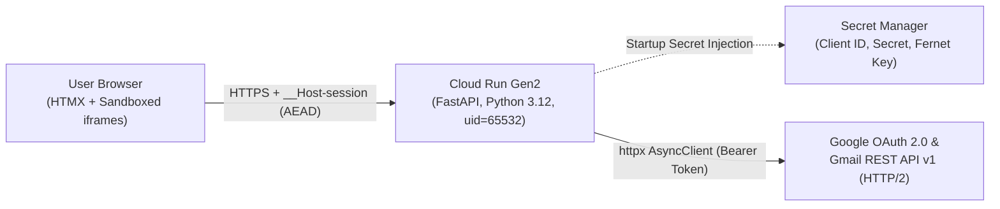

# MyMailApp

A lightweight, stateless web application for searching a user's Gmail inbox, reading full conversation threads, and downloading attachments—built with **Python 3.12+**, **FastAPI**, **HTMX**, and **Google Cloud Run**.

Designed around strict least-privilege security and zero backend persistence: no emails, search queries, attachments, or OAuth tokens are ever stored in a database.

---

## Key Security & Architectural Highlights

- **Strict Minimum Gmail Permission:** Requests exclusively `https://www.googleapis.com/auth/gmail.readonly` using OAuth 2.0 Authorization Code + **PKCE (`S256`)** and constant-time CSRF `state` verification. (`gmail.metadata` is not viable because the Gmail API blocks the `q` search parameter under metadata scope with `403 Forbidden`.)
- **Stateless AEAD-Encrypted Cookies:** OAuth tokens are sealed in the browser using **Fernet (AES-128-CBC + HMAC-SHA256)** inside an `HttpOnly`, `Secure`, `SameSite=Lax` `__Host-session` cookie (`< 4 KB` enforced), transparently refreshed before expiry, and revoked server-side at Google upon sign-out.
- **Hostile Email HTML Isolation:** Untrusted HTML bodies are sanitized server-side with **nh3** (Rust Ammonia bindings), remote tracking pixels (`http://` / `https://` images) are blocked by default behind an explicit opt-in toggle, and each message renders inside an isolated `<iframe sandbox="" referrerpolicy="no-referrer" srcdoc="...">` under a strict `script-src 'self'` Content Security Policy.
- **Non-Blocking HTTP/2 Concurrency:** Uses a shared lifespan-managed `httpx.AsyncClient(http2=True)` with bounded `asyncio.Semaphore` concurrency and strict **Pydantic v2** models rather than blocking synchronous `httplib2` clients.
- **Zero-Trust Serverless Deployment:** Runs as unprivileged `uid=65532` on **Cloud Run Gen2** (`min-instances=0`, scale-to-zero) with separated Cloud Build and Runtime service accounts holding zero project-wide data roles.

---

## Architecture Overview



### Repository Structure

```text
.
├── Dockerfile                  # Multi-stage Python 3.12 + uv bytecode build (non-root uid 65532)
├── pyproject.toml              # Project metadata, dependencies, ruff & pytest configuration
├── uv.lock                     # Deterministic PyPI lockfile
├── PRD.md                      # Product Requirements Document
├── ARCHITECTURE_AND_PLAN.md    # Detailed cloud & software architecture specification
├── scripts/
│   ├── 01-bootstrap-gcp.sh     # Enables APIs, Artifact Registry, build bucket, SAs & secrets
│   ├── 02-store-oauth-secrets.sh # Interactive hidden-input OAuth secret ingestion
│   ├── 03-deploy.sh            # Runs quality gates, Cloud Build, Cloud Run deploy & smoke check
│   └── 04-teardown.sh          # Cleanly deletes provisioned GCP resources
├── src/mymailapp/
│   ├── main.py                 # FastAPI app factory, CSP middleware & cookie rotation
│   ├── config.py               # Strict pydantic-settings configuration (extra="forbid")
│   ├── dependencies.py         # DI providers & transparent access-token refresh guard
│   ├── auth/                   # Fernet cookie cipher & OAuth 2.0 PKCE S256 client
│   ├── gmail/                  # Async HTTP/2 Gmail client, MIME parser & nh3 sanitizer
│   ├── routes/                 # /auth/* and /, /search, /threads/*, /messages/*/attachments/*
│   ├── templates/              # Jinja2 templates + HTMX partials
│   └── static/                 # Local CSS, app.js, and vendored htmx.min.js
└── tests/                      # 44 unit & end-to-end async ASGI route tests
```

---

## Local Development

### Prerequisites
- Python `3.12+`
- [`uv`](https://docs.astral.sh/uv/)
- A Google Cloud project with the **Gmail API** enabled and an **OAuth 2.0 Web Client** configured with `http://localhost:8000/auth/callback` as an Authorized Redirect URI.

### Setup & Run

```bash
# 1. Install dependencies into .venv
uv sync

# 2. Create local .env from template (never committed)
cp .env.example .env

# 3. Generate a 32-byte Fernet session encryption key and set SESSION_ENCRYPTION_KEY in .env
uv run python -c "from cryptography.fernet import Fernet; print(Fernet.generate_key().decode())"

# 4. Populate GOOGLE_CLIENT_ID and GOOGLE_CLIENT_SECRET in .env, then start the dev server
uv run uvicorn mymailapp.main:create_app --factory --reload --port 8000
```

Open `http://localhost:8000` in your browser.

---

## Deploying to Google Cloud Run

All provisioning and deployment scripts in `scripts/` are idempotent and parameterized via environment variables:

| Variable | Required | Default | Description |
|---|---|---|---|
| `PROJECT_ID` | **Yes** | *(none)* | Target Google Cloud Project ID (must have billing linked) |
| `REGION` | No | `us-central1` | GCP region for Cloud Run, Artifact Registry, GCS, and Secrets |
| `SERVICE_NAME` | No | `mymailapp` | Cloud Run service name |
| `AR_REPO` | No | `mymailapp` | Artifact Registry Docker repository name |

### Step 1: Bootstrap GCP Project Infrastructure

```bash
export PROJECT_ID="your-gcp-project-id"
./scripts/01-bootstrap-gcp.sh
```

This enables the required APIs (`gmail`, `run`, `artifactregistry`, `cloudbuild`, `secretmanager`, `iam`), creates the Docker registry and 1-day lifecycle build staging bucket, provisions least-privilege `mymailapp-builder` and `mymailapp-runner` service accounts, initializes the Fernet session key in Secret Manager, and prints your deterministic Cloud Run callback URL:
`https://mymailapp-<PROJECT_NUMBER>.<REGION>.run.app/auth/callback`

### Step 2: Configure Google OAuth 2.0 Client (One-Time Console Step)

GCP does not expose a public CLI/API for creating External Web OAuth clients. Open `https://console.cloud.google.com/auth/overview?project=<PROJECT_ID>`:

1. **Branding / Audience:** Set app name, select **External**, keep publishing status in **Testing**, and add your allowlisted Gmail address(es) under **Test users**. (Note: Google expires Testing-mode refresh tokens every 7 days; the app handles `invalid_grant` automatically by prompting a fresh login.)
2. **Data Access (Scopes):** Add **only** `https://www.googleapis.com/auth/gmail.readonly`.
3. **Clients -> Create Client:** Choose **Web application** and register the Authorized Redirect URIs printed by Step 1 (`http://localhost:8000/auth/callback` and `https://mymailapp-<PROJECT_NUMBER>.<REGION>.run.app/auth/callback`).

### Step 3: Store OAuth Credentials in Secret Manager

```bash
./scripts/02-store-oauth-secrets.sh
```

Prompts interactively (with secret input hidden from terminal history) and writes `mymailapp-oauth-client-id` and `mymailapp-oauth-client-secret` to Secret Manager while disabling superseded versions.

### Step 4: Build, Deploy & Smoke-Test

```bash
./scripts/03-deploy.sh
```

Runs `ruff` and `pytest` locally, builds the container via Cloud Build, deploys to Cloud Run Gen2, and verifies HTTP `200` on `/health` and HTTP `302` on `/`.

### Optional Teardown

```bash
./scripts/04-teardown.sh
```

---

## Quality Gates & Testing

```bash
uv run ruff check .
uv run ruff format --check .
uv run pytest -v
```
